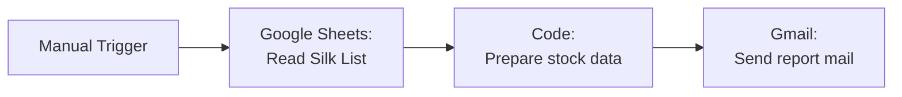

# 🧵 Saree Stock Report — n8n + Google Sheets + Gmail

An n8n workflow for a saree retail store. It reads the inventory from a Google Sheet and calculates a stock summary: item counts, pieces, and stock value at cost and selling price. It flags low-stock and mismatched rows, then emails a formatted HTML report.


---

## ✨ What it does

1. Reads the **Silk List** tab of the store's stock sheet.
2. Keeps only real product rows, meaning those whose **Item ID starts with `SIS`**.
3. Calculates:
   - Total items, **In Stock** and **Sold Out** counts
   - Total pieces in stock
   - Stock value at **cost price** and at **selling price**, in ₹ with Indian number formatting
4. Flags:
   - **Low stock:** items with only 1 piece left
   - **Status mismatches:** rows marked *Sold out* with stock > 0, or *In stock* with stock = 0
5. Emails a branded HTML report with summary cards, a low-stock table and a list of rows to fix.

No AI model is involved. All the calculations run in a single **Code node** (JavaScript), so the numbers are exact and repeatable.

---

## 🔀 Workflow



| Node | Type | Purpose |
|---|---|---|
| When clicking 'Execute workflow' | Manual Trigger | Runs the report on demand |
| Read Silk List | Google Sheets | Reads the sheet, with headers in **row 2** and data from **row 3** |
| Prepare stock data | Code (JavaScript) | Filters rows, calculates totals and flags, and builds the HTML email and subject |
| Send a report mail | Gmail | Sends the report with subject `Saree Stock Report – <date>` |

---

## 📋 Expected sheet format

Row 1 can hold a title. **Row 2 must contain these column headers** (the names must match exactly):

| Item ID | Item name | Stock | Status | Actual price | Selling price |
|---|---|---|---|---|---|
| SIS001 | Kanchipuram Pure Silk – Maroon | 2 | In stock | 8,500 | 11,900 |
| SIS002 | Soft Silk – Bottle Green | 1 | In stock | 3,200 | 4,500 |
| SIS003 | Banarasi Silk – Gold | 0 | Sold out | 6,000 | 8,400 |

- **Item ID** must start with `SIS`. Other rows, such as subtotals or notes, are ignored.
- **Status** must be `In stock` or `Sold out`. Capitalisation doesn't matter.
- Prices can include `₹`, commas or spaces, because the code cleans them before calculating.

---

## 📧 Sample report

```
Sri Iniya Silks – Stock Report
Silk List · 21 Oct 2026

[ Total Items 3 ] [ In Stock 2 ] [ Sold Out 1 ] [ Pieces 3 ]
[ Value at Cost ₹20,200 ]  [ Value at Selling Price ₹28,300 ]

Low Stock – only 1 piece left (1)
| SIS002 | Soft Silk – Bottle Green |

✓ No status mismatches found.
```

*(The real email is styled HTML with coloured summary cards and a maroon-themed table.)*

---

## ⚙️ Setup

### Prerequisites
- An n8n instance (n8n Cloud or self-hosted)
- A Google account with access to the stock sheet

### Steps
1. In n8n, go to **Workflows → Import from File** and select `Saree Stock Total – Silk List.json`.
2. Add credentials:
   - **Google Sheets OAuth2:** assign it to *Read Silk List*.
   - **Gmail OAuth2:** assign it to *Send a report mail*.
3. In *Read Silk List*, select **your** spreadsheet and tab.
4. In *Send a report mail*:
   - set **To** to your email address
   - make sure **Email Type** is **HTML**
5. Click **Execute workflow** and check your inbox.

---

## 🛠️ Customisation

| Want to… | Change |
|---|---|
| Get the report automatically | Replace the Manual Trigger with a **Schedule Trigger** (e.g. daily at 9 PM after closing) |
| Change the low-stock threshold | In the Code node, change `qty === 1` to `qty <= 2` (or any limit) |
| Report on another category (cotton, etc.) | Duplicate the workflow and point it at that tab, or loop through several tabs |
| Use a different ID prefix | Change `startsWith('SIS')` in the Code node |
| Send to several people | Add comma-separated addresses in the Gmail **To** field |
| Rebrand the email | Edit the colours (`#8b1a1a`, `#f7f3ee`) and title in the HTML template |

---

## ⚠️ Known limitations

- **Manual run only:** nothing runs until you execute it. Add a Schedule Trigger for daily reports.
- **Only two statuses are counted:** rows with any other status (e.g. *Reserved*) are counted in Total Items, but not in In Stock or Sold Out.
- **Date timezone:** the report date comes from the n8n server clock. On a non-IST server, runs near midnight may show the wrong day. Passing `timeZone: 'Asia/Kolkata'` to `toLocaleDateString` fixes this.
- **Item names are inserted into the HTML as-is.** A name containing `<` or `&` could display oddly.
- **One sheet tab per run:** the workflow reports only on the *Silk List* tab.

---

## 📚 Learnings

Built to automate a real stock check for a family saree store. It covers:
- Reading Google Sheets with a **custom header row and data range**
- Data cleaning and aggregation in an n8n **Code node**
- Generating **email-safe HTML** (inline styles, table layout) for Gmail

---

**Author:** [Dineshkumar Palanisamy](https://www.linkedin.com/in/pdineshkumar55) · [GitHub](https://github.com/pdineshkumar55)
